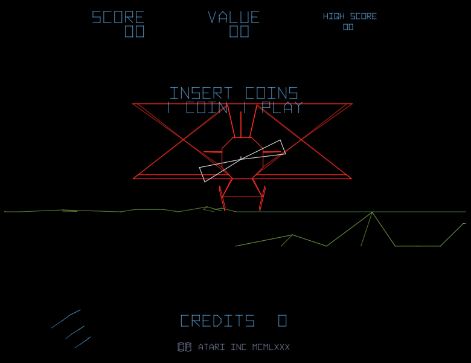
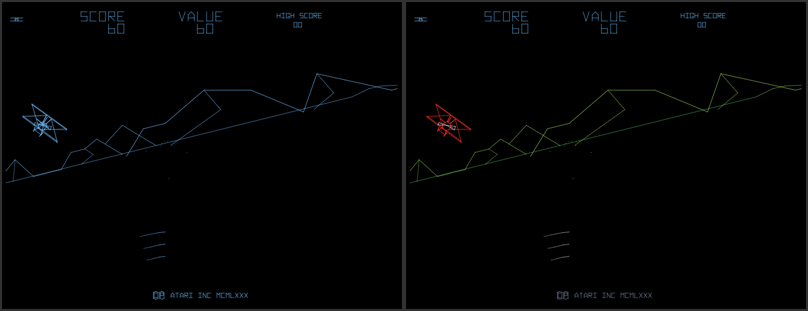
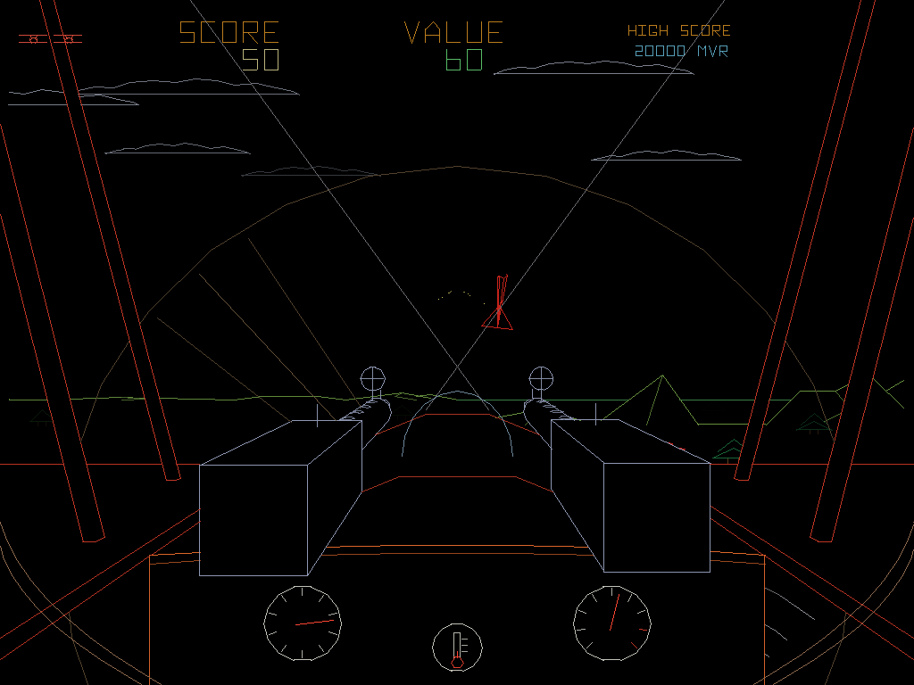
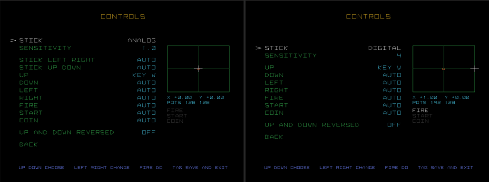
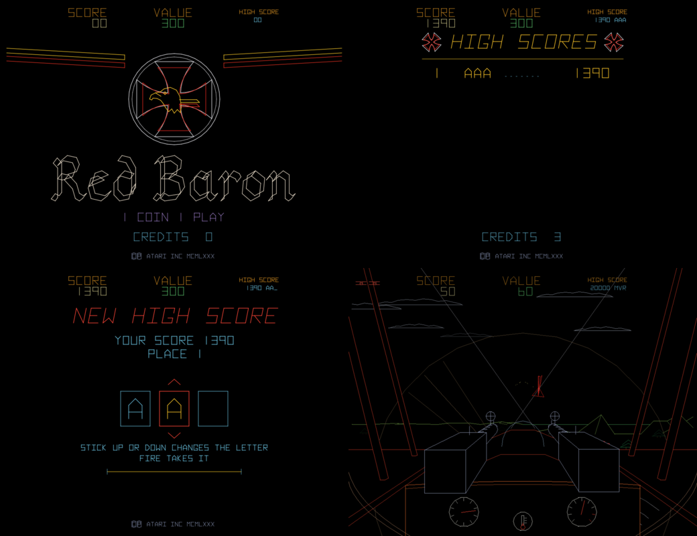

# Red Baron Enhanced

Red Baron (Atari, 1981) as a C program for the VectorPie cabinet and the
PC, translated from the original source code
([historicalsource/red-baron](https://github.com/historicalsource/red-baron))
and checked frame by frame against MAME.

Sister projects made the same way: Battlezone Enhanced, Star Wars
Enhanced.




## What it is

* The whole game program in C: 174 routines under their original names,
  with the comments of 1981, in the cabinet's memory map. No 6502 in
  normal operation.
* The board's parts emulated: Math Box, vector generator, POKEY, the
  discrete sounds (machine gun, nose dive, explosion), EAROM.
* Pictures, landscape, planes and tunes stay in the ROMs and are read at
  start from your own MAME set `redbaron`. They are not part of this
  project.

Additions over the cabinet, each one can be switched off:

* **Smooth picture** (`smooth = 3`): 60 pictures a second instead of 10,
  each drawn by the game itself from its state at that moment, as in Star
  Wars Enhanced.
* **Color** (`color_lines = yes`): the land green, bullets yellow, the
  blimp in several colors; the enemy planes (the player flies the Red
  Baron, the foes are British) khaki with roundels.
* **Occlusion** (`occlusion = yes`): biplanes, mountains and ground
  objects hide what lies behind them.
* **Trees and clouds** (`trees`, `clouds`): drawn with the game's own
  routines, the way it draws its own objects on the ground.
* **Calibrated stick** (`stick_calibrate = yes`): the plane no longer
  drifts to one side after the first deflection.
* **Cockpit** (`cockpit = yes`): the triplane's cockpit seen from the
  seat: two machine guns with ring sights that kick as they fire, nose and
  propeller, middle wing with struts, bracing wires, dashboard with
  altimeter, airspeed indicator and gun thermometer; all with occlusion.
  Only a picture, the game stays the same.


* **Title, high score table, initials entry** (`screens = yes`): the
  port's own pictures of these game states, with iron cross, eagle and
  Fraktur lettering; empty tables get the aces of 1917
  (`default_scores`).
* **High scores in the cabinet's menu**: the game's table shows on the
  marquee and in the hint bar like those of the other VectorPie games.
* **Real free play** (`coin_mode = free`): the attract mode runs, START
  begins a game.
* **Real gameplay in the attract mode** (`attract_demo = yes`): an
  autopilot plays on a second, silent machine; the real game is not
  touched.
* **Real sounds** (`sounds = samples`): the player's engine is a Fokker
  biplane from Hollywood sound recordings of the 1930s (faster diving,
  slower climbing), the enemy coming at you a Nieuport with a rotary
  engine, the machine gun a Maxim (the gun of the Spandau LMG 08/15), plus
  explosions and planes spinning down, quieter and duller the farther away
  they are. The tunes stay the POKEY's. Recordings from Freesound, sources
  in `package/sounds/CREDITS.txt`; listen in `docs/listen/`.
* **The cabinet's volumes**: the sound goes through the VectorPie SDK's
  mixer, so the menu's MUSIC VOLUME applies to it, on top of the game's
  own VOLUME.
* **Test menu** (service key F2, or hold start and fire for two seconds),
  only the essentials: bindings, analog or digital control with
  sensitivity and a yoke test next to it, picture and game options, test
  picture, sound test, clearing the high scores.




The current state is in [STATUS.md](STATUS.md).

## Running

```bash
build/pc/redbaron.exe --windowed --roms D:/Mame/roms
```

| Action (name in advmame.rc) | Meaning |
|---|---|
| `p1_stickx`, `p1_sticky` or `p1_left/right/up/down` | flight stick |
| `p1_button1` | machine gun |
| `start1` | start |
| `coin1`, `coin2` | coin |
| `ui_cancel` | quit |
| `service` (F2) | test menu (open; save and back). The key comes from `advmame.rc` (`input_map[service]`, as VectorPie's CONTROLS settings and AdvanceMAME write it); if nothing is there, F2 |

That is the binding "auto"; in the test menu every action can be put on
any key, button, hat or axis. Without `advmame.rc` (on a PC)
AdvanceMAME's defaults apply, usually the arrow keys, left Ctrl, 1, 5 and
Esc.

Settings: `redbaron.ini` (defaults next to the program, your own in
`save/redbaron.ini`, which the test menu writes): controls and bindings,
picture area and margins, brightness, color, volume, sounds, language,
bonus lives, lives, coins. The high scores are in `save/earom.bin` (and,
for the menu, in `save/highscores.txt`).

`--original` runs the original program on a 6502 core for comparison.

## Installing on the cabinet

Download `rbenhanced-<version>.vpk` from the
[releases](https://github.com/Endprodukt/RedBaronEnhanced/releases), put it
in a USB drive's `games/` folder and plug the drive in (or copy it to
`/persistent/games/packages/`), then Settings -> GAMES -> INSTALL GAMES.
The game needs the MAME ROM set `redbaron` in the cabinet's ROM folder.

## Building and checking

See [BUILD.md](BUILD.md). How it looks inside and how to carry on:
[RESUME.md](RESUME.md).
