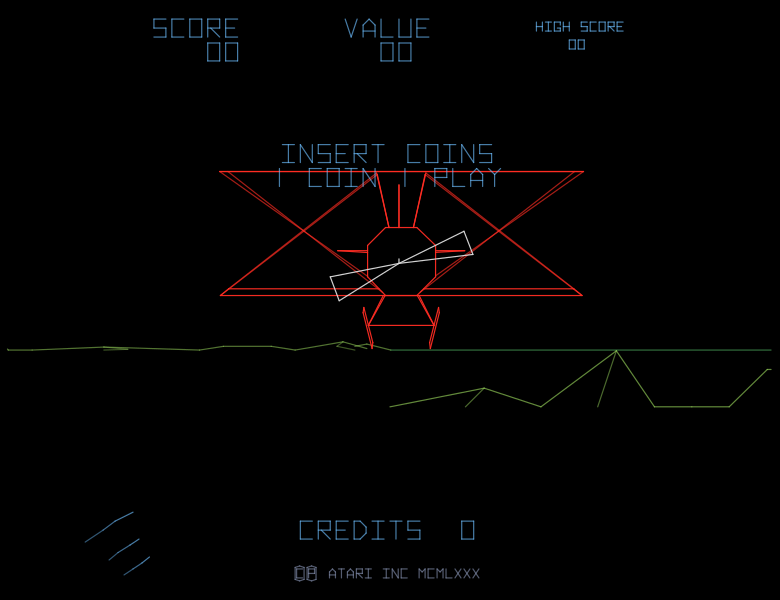
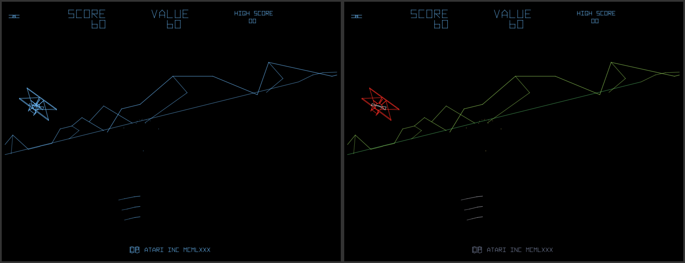
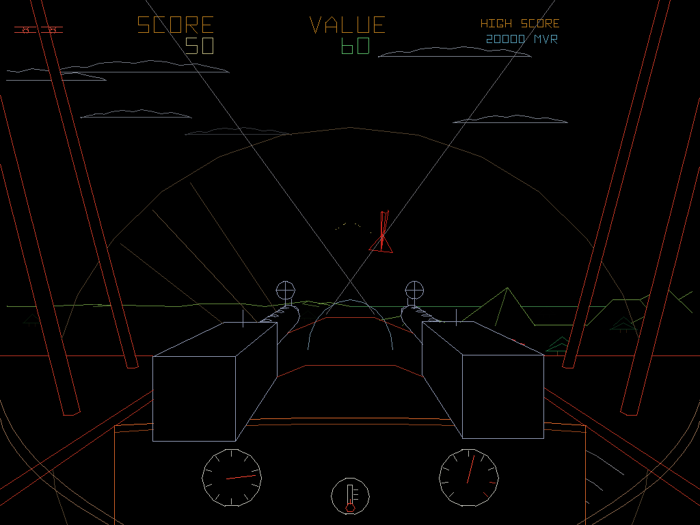
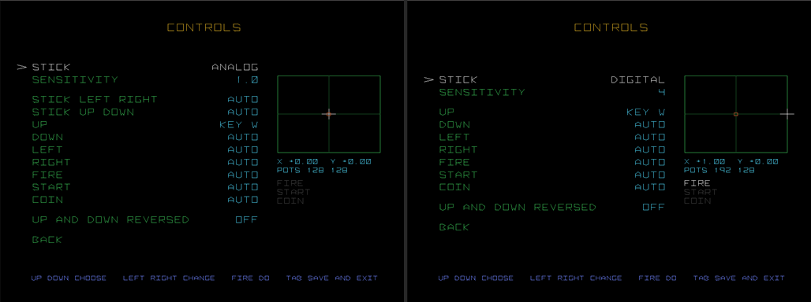
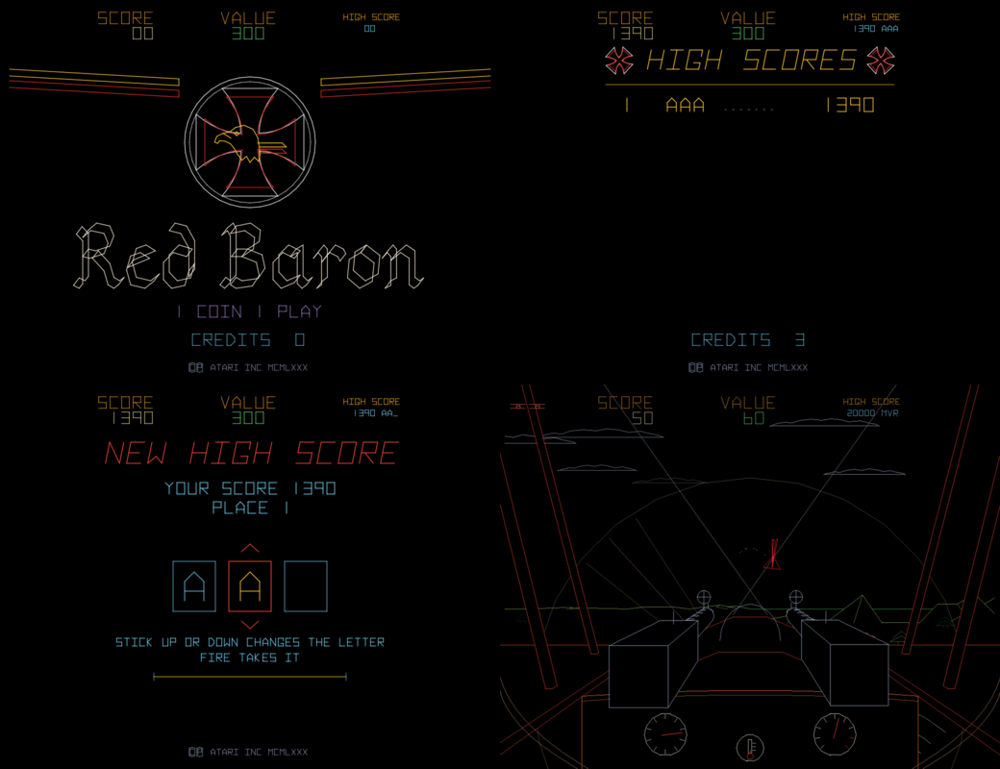

# Red Baron Enhanced

Red Baron (Atari, 1981) als C-Programm für den VectorPie-Automaten und den
PC, übersetzt aus dem Originalquelltext
([historicalsource/red-baron](https://github.com/historicalsource/red-baron))
und Frame für Frame gegen MAME geprüft.

Schwesterprojekte mit demselben Vorgehen: Battlezone Enhanced, Star Wars
Enhanced.




## Was es ist

* Das ganze Spielprogramm in C: 174 Routinen unter ihren Originalnamen, mit
  den Kommentaren von 1981, im Speicherbild des Automaten. Kein 6502 im
  normalen Betrieb.
* Die Bausteine der Platine nachgebildet: Math Box, Vektorgenerator, POKEY,
  die diskreten Sounds (Maschinengewehr, Sturzflug, Explosion), EAROM.
* Bilder, Landschaft, Flugzeuge und Melodien bleiben in den ROMs und werden
  beim Start aus dem eigenen MAME-Satz `redbaron` gelesen. Sie sind nicht
  Teil dieses Projekts.

Ergänzungen gegenüber dem Automaten, jede abschaltbar:

* **Flüssiges Bild** (`smooth = 3`): 60 Bilder pro Sekunde statt 10, jedes
  vom Spiel selbst aus dem Zustand dieses Augenblicks gezeichnet, wie bei
  Star Wars Enhanced.
* **Farbe** (`color_lines = yes`): der Rote Baron rot, das Land grün,
  Schüsse gelb, der Zeppelin silber.
* **Verdeckung** (`occlusion = yes`): Doppeldecker, Berge und Bodenobjekte
  verdecken, was hinter ihnen liegt.
* **Bäume und Wolken** (`trees`, `clouds`): gezeichnet mit den Routinen des
  Spiels, so wie es seine eigenen Objekte am Boden zeichnet.
* **Kalibrierter Knüppel** (`stick_calibrate = yes`): Das Flugzeug zieht
  nach dem ersten Ausschlag nicht mehr zur Seite.
* **Cockpit** (`cockpit = yes`): das Cockpit des Dreideckers aus dem Sitz
  gesehen: zwei MGs mit Ringvisier, die beim Feuern zurückschlagen, Bug
  und Propeller, Mittelflügel mit Streben, Spanndrähte, Instrumentenbrett
  mit Höhenmesser, Fahrtmesser und Waffenthermometer; alles mit Verdeckung.
  Nur ein Bild, das Spiel bleibt gleich.


* **Titel, Highscore-Tafel, Initialeneingabe** (`screens = yes`): eigene
  Bilder der Spielzustände, mit Eisernem Kreuz, Adler und
  Fraktur-Schriftzug; leere Tafeln bekommen die Asse von 1917
  (`default_scores`).
* **Highscores im Automaten-Menü**: die Tafel des Spiels erscheint wie bei
  den anderen VectorPie-Spielen auf dem Marquee und in der Hinweiszeile.
* **Richtiges Freispiel** (`coin_mode = free`): der Attract läuft, START
  beginnt ein Spiel.
* **Echtes Gameplay im Attract** (`attract_demo = yes`): ein Autopilot
  spielt auf einer zweiten, stummen Maschine; das echte Spiel bleibt
  unberührt.
* **Echte Geräusche** (`sounds = samples`): eigener Motor ist ein Fokker-
  Doppeldecker aus Hollywood-Tonaufnahmen der 30er Jahre (im Sturz
  schneller, im Steigen langsamer), der anfliegende Gegner ein Nieuport mit
  Umlaufmotor, das MG ein Maxim (die Waffe des Spandau LMG 08/15),
  dazu Explosionen und ein trudelndes Flugzeug. Die Melodien bleiben vom
  POKEY. Aufnahmen von Freesound, Quellen in `package/sounds/CREDITS.txt`;
  Hörprobe in `docs/hoerprobe/`.
* **Testmenü** (Service-Taste F2, oder Start und Feuer zwei Sekunden
  halten), nur das
  Nötigste: Belegung, analoge oder digitale Steuerung mit Empfindlichkeit
  und Yoke-Test daneben, Bild- und Spieloptionen, Testbild, Soundtest, Highscores
  löschen.




Der Stand steht in [STATUS.md](STATUS.md).

## Starten

```bash
build/pc/redbaron.exe --windowed --roms D:/Mame/roms
```

| Aktion (Name in advmame.rc) | Bedeutung |
|---|---|
| `p1_stickx`, `p1_sticky` oder `p1_left/right/up/down` | Steuerknüppel |
| `p1_button1` | Maschinengewehr |
| `start1` | Start |
| `coin1`, `coin2` | Münze |
| `ui_cancel` | Beenden |
| `service` (F2) | Testmenü (öffnen; speichern und zurück). Die Taste kommt aus `advmame.rc` (`input_map[service]`, wie VectorPies CONTROLS-Einstellungen und AdvanceMAME sie schreiben); steht dort nichts, gilt F2 |

Das ist die Belegung „auto"; im Testmenü lässt sich jede Aktion auf eine
beliebige Taste, einen Knopf, Hat oder eine Achse legen. Ohne `advmame.rc`
(am PC) gelten die Vorgaben von AdvanceMAME, üblich sind Pfeiltasten,
Strg links, 1, 5 und Esc.

Einstellungen: `redbaron.ini` (Vorgaben neben dem Programm, eigene in
`save/redbaron.ini`, die das Testmenü schreibt): Steuerung und Belegung,
Bildausschnitt und Ränder, Helligkeit, Farbe, Lautstärke, Sprache,
Bonusleben, Leben, Münzen. Die Highscores liegen in `save/earom.bin`.

`--original` lässt zum Vergleich das Originalprogramm auf einem
6502-Kern laufen.

## Bauen und Prüfen

Siehe [BUILD.md](BUILD.md). Wie es innen aussieht und wie man weitermacht:
[RESUME.md](RESUME.md).
